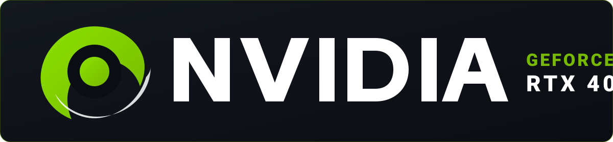
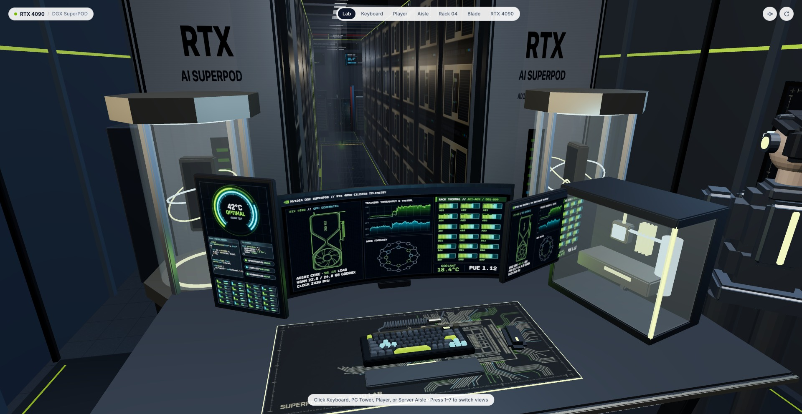
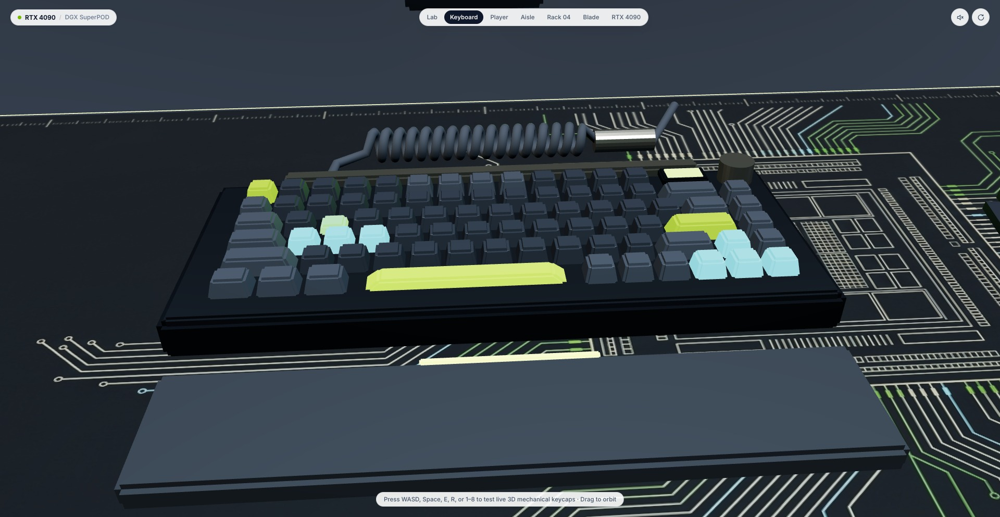
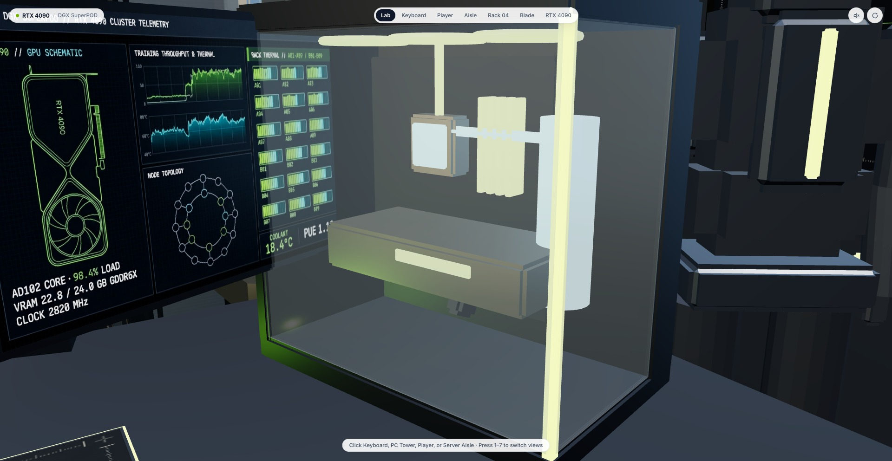
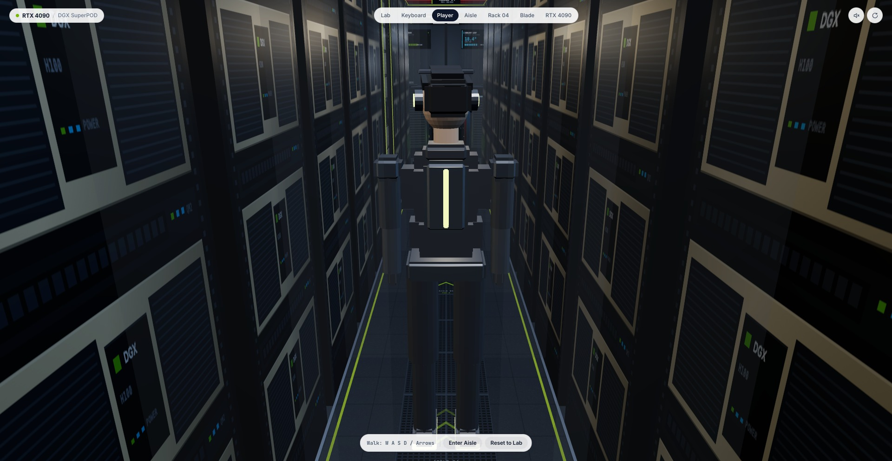
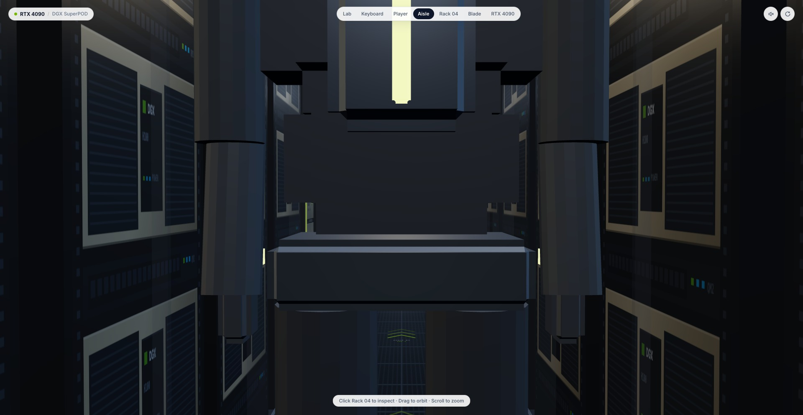
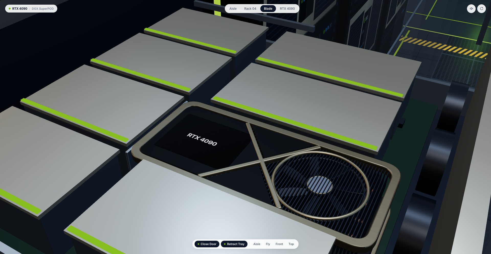
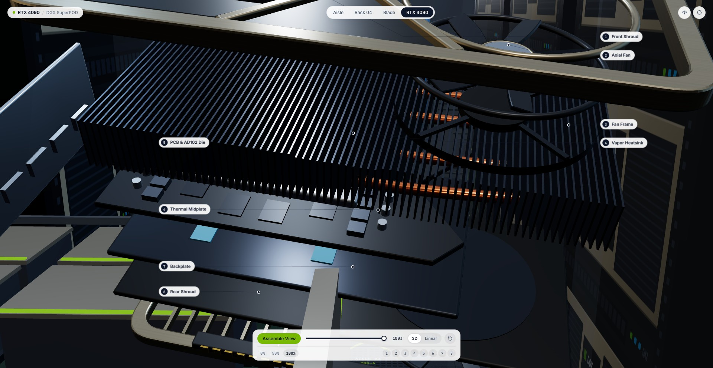
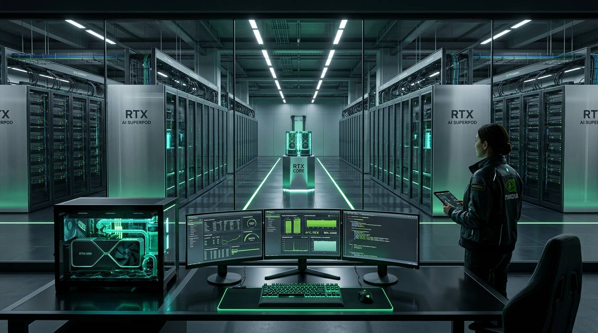
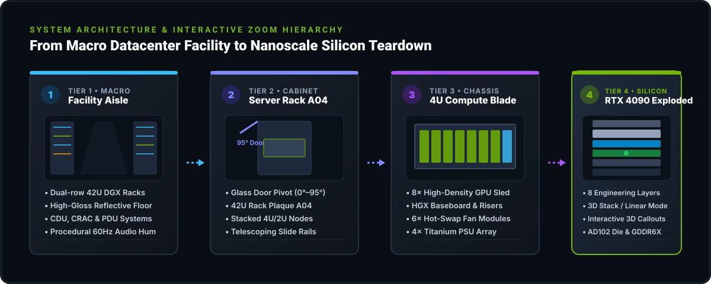

<div align="center">

  

  # 🏢 NVIDIA DGX SuperPOD™ AI Datacenter & RTX 4090
  ### *Photorealistic 3D Digital Twin • Multi-Scale Facility Simulation • 8-Layer Hardware Teardown*

  [](https://threejs.org/)
  [](https://www.khronos.org/webgl/)
  [](https://www.nvidia.com/en-us/geforce/graphics-cards/40-series/rtx-4090/)
  [](https://developer.mozilla.org/en-US/docs/Web/JavaScript)
  [](https://developer.mozilla.org/en-US/docs/Web/API/Web_Audio_API)
  [](https://threejs.org/)
  [](LICENSE)

  <p align="center">
    <strong>An interactive, high-fidelity 3D web application modeling an enterprise AI Supercomputing Datacenter and an ultra-detailed procedural NVIDIA GeForce RTX 4090 Founders Edition graphics card built with Three.js and WebGL 2.0.</strong>
  </p>

</div>

---

## 📸 Visual Showcase & Facility Walkthrough

<div align="center">

### 🧪 1. Computer Lab Observation Deck & Glass Portal into Aisle 04

<p><em>Blender-authored Gaming Workstation, 3D Mechanical Keyboard, Triple Telemetry Monitors, Panoramic Liquid-Cooled PC, Cyber-Engineer Player Avatar, and Twin Cryo GPU Core Pedestals overlooking the 42U DGX SuperPOD Aisle.</em></p>

<br/>

| ⌨️ 2. 3D Mechanical Gaming Keyboard (Live Reactive) | 🖥️ 3. Panoramic Liquid-Cooled PC Tower |
| :---: | :---: |
|  |  |
| *75% sculpted keycaps, rotary knob, OLED screen, coiled aviator cable & AD102 desk mat.* | *Tempered glass dual-chamber rig with RTX GPU, DDR5 RAM & custom cooling loop.* |

<br/>

| 🚶 4. Third-Person Player Walk Mode | 🏢 5. Facility Aisle 04 (Macro Corridor) |
| :---: | :---: |
|  |  |
| *Walk the articulated Cyber-Engineer avatar with WASD between Lab & Server Aisle.* | *Dual 42U DGX server rows, reflective floor tiles & illuminated wayfinding.* |

<br/>

| 🗄️ 6. 4U Compute Blade (Rack A04 Extended) | 🔬 7. RTX 4090 8-Layer Exploded View |
| :---: | :---: |
|  |  |
| *Slide-out 4U chassis with 8× GPU bay and hero RTX 4090.* | *Real-time deconstruction into 8 constituent assemblies with 3D callouts.* |

<br/>

| 🎨 8. Concept Vision (Image-Gen Design) | 🗺️ 9. Multi-Scale Hierarchy Diagram |
| :---: | :---: |
|  |  |
| *AI-generated architectural vision guiding the Lab, PC, Keyboard & Cryo Core design.* | *Multi-scale interactive pipeline from Command Lab to nanoscale silicon.* |

</div>

---

## 🌟 Key Highlights & Engineering Features

### 🏢 1. Photorealistic AI Datacenter Supercomputer Facility
- **Dual-Aisle 42U Server Farm**: Opposing rows of 42U server cabinets with brushed aluminum rails, individual rack plaques (`A01–A09` / `B01–B09`), and dynamic blinking activity telemetry LEDs (blue, cyan, green, and amber).
- **High-Gloss Reflective Raised Access Floor**: Procedural 600×600 mm raised tile floor with anti-static laminate speckle, specular highlights, and mirror reflections mirroring the illuminated corridor.
- **Crystal-Clear Tempered Glass Doors**: Realistic transparency (`opacity: 0.24`, `roughness: 0.03`) allowing full inspection of internal server chassis and GPU arrays even when doors are closed.
- **Overhead Cable Ladder Trays**: Suspended galvanized structural cable trays with instanced rungs carrying yellow and blue high-speed fiber-optic trunk conduits.
- **Industrial Facility Equipment**: Integrated 3D models for **CDU (Coolant Distribution Unit)**, **CRAC (Computer Room Air Conditioning)**, and **PDU (Power Distribution Unit)** infrastructure.
- **Procedural Datacenter Audio Synthesizer**: Built-in Web Audio API generator synthesizing a dual 60Hz/120.6Hz transformer hum, 30Hz sub-drone, and resonant 460Hz lowpass-filtered pink noise airflow with mute/unmute control.

### 🔬 2. NVIDIA GeForce RTX 4090 Founders Edition (Ada Lovelace Teardown)
- **Real Teardown Proportions**: Modeled directly after physical engineering teardowns down to the chamfered titanium-champagne figure-8 perimeter frame.
- **8-Layer Exploded Engineering View**: Smooth real-time separation using vector lerp interpolation into 8 constituent assemblies.
- **Dual Deconstruction Modes**: Toggle between **3D Stack (Layered Depth)** and **Linear Blueprint (Axial Breakdown)**.
- **Dynamic 3D Screen-Projected Callouts**: Interactive badges with dynamic SVG leader lines tracking components in 3D world space.
- **Technical Specification Drawer**: Interactive drawer displaying real-world material compositions, thermal specs, silicon dies, and clock dimensions.
- **Counter-Rotating Dual Axial Fans**: 7-blade curved 120mm fluid-bearing front intake fan and counter-rotating rear exhaust fan.

---

## 🗺️ Interactive Multi-Scale Architecture Tour

Explore the simulation across four seamless levels of detail:

<div align="center">
  
</div>

```text
[ Level 1: Facility Aisle ] ──▶ [ Level 2: Server Rack A04 ] ──▶ [ Level 3: 4U Compute Sled ] ──▶ [ Level 4: RTX 4090 Teardown ]
       (Macro Corridor)             (Door Pivot 0°–95°)              (8× GPU Sled Extended)             (8-Layer Exploded View)
```

| Zoom Level | View Mode | Description | Key Interactions |
| :---: | :--- | :--- | :--- |
| **Level 1** | **🏢 Facility Aisle** | Wide-angle corridor perspective capturing the full length of the server rows, overhead cable ladders, and floor reflections. | Click any server rack to focus; camera flythrough; auto-orbit. |
| **Level 2** | **🖥️ Server Rack A04** | Close-up beauty shot of Hero Cabinet A04 with illuminated plaque and status arrays. | Press <kbd>D</kbd> or click button to pivot glass door open (0°–95°). |
| **Level 3** | **🗄️ 4U GPU Compute Sled** | Telescoping 4U server chassis smoothly slides forward on 3-stage steel slide rails. | Press <kbd>T</kbd> to extend sled; inspect 8× GPU bay layout. |
| **Level 4** | **🔬 RTX 4090 Exploded View** | Camera zooms into the hero RTX 4090 card, unlocking the 8-part engineering deconstruction view. | Press <kbd>Space</kbd> / <kbd>E</kbd> to explode; scrub 0%–100% slider; click parts 1–8. |

---

## 🔬 RTX 4090 Component Breakdown (8 Assemblies)

When toggling the **Exploded View**, the card separates into its precision-engineered assemblies:

<div align="center">
  
</div>

| # | Assembly | Real-World Engineering Details | Exploded Motion |
| :-: | :--- | :--- | :--- |
| **1** | **Front Shroud & Figure-8 Frame** | Extruded titanium-champagne anodized aluminum hourglass frame with matte charcoal inner plate, laser-engraved typography, and cooling fin wedges. | Displaces upward (`+Y, +Z`) |
| **2** | **Axial Intake Fan** | 120mm fluid-dynamic bearing fan with 7 curved swept-profile blades, counter-rotating airflow aerodynamics, and central metallic hub. | Displaces upward (`+Y`) |
| **3** | **Cast Inner Fan Frame** | Die-cast aluminum structural perimeter skeleton with integrated vibration-dampening mounting lugs. | Floats between fan & heatsink |
| **4** | **Heatsink & Heat Pipes** | 76-fin dark anodized radiator stack rendered in 1 draw call via `InstancedMesh` with 4 looping sintered copper heat pipes and mirror nickel-plated vapor chamber. | Displaces upward (`+Y`) |
| **5** | **Custom V-Notch PCB & AD102 Die** | Matte-black PCB with real FE notch shape, mirror AD102 silicon core, 12 Micron 2GB GDDR6X VRAM modules (24 GB total), LR22 VRM power chokes, and SMD capacitors. | Centers on baseline (`0, 0, 0`) |
| **6** | **Die-Cast Thermal Midplate** | Perimeter structural stiffener with laser-cut blue silicone thermal pads for memory modules and DrMOS power stages. | Displaces downward (`-Y`) |
| **7** | **Anodized Backplate & X-Bracket** | Aerospace-grade alloy backplate with airflow cutouts, spring-loaded retention X-bracket, and laser-etched GeForce RTX branding. | Displaces downward (`-Y, -Z`) |
| **8** | **Rear Shroud & Exhaust Fan** | Flow-through rear exhaust system drawing heat directly across the heatsink and venting through the chassis. | Displaces downward (`-Y, -Z`) |
| **EXT** | **I/O Bracket & Connectors** | Triple-slot brushed stainless steel bracket with 3× DisplayPort 1.4a, 1× HDMI 2.1, gold PCIe 4.0 x16 interface, and 16-pin 12VHPWR auxiliary power header. | Displaces outward (`-X, -Z`) |

---

## 🕹️ Interactive Controls & Keyboard Shortcuts

<div align="center">

| Shortcut | UI Action | Description |
| :---: | :--- | :--- |
| <kbd>1</kbd> | **Computer Lab View** | Panoramic Lab desk, triple monitors, PC rig, keyboard & glass portal |
| <kbd>2</kbd> | **3D Keyboard View** | Macro close-up of the Blender mechanical gaming keyboard |
| <kbd>3</kbd> | **Player Walk Mode** | Third-person control (`W/A/S/D` or Arrows) to explore Lab & Server Room |
| <kbd>4</kbd> | **Facility Aisle View** | Switch to wide macro datacenter corridor perspective |
| <kbd>5</kbd> | **Server Rack View** | Focus camera on Hero Cabinet A04 |
| <kbd>6</kbd> | **GPU Blade View** | Inspect slide-out 4U 8× GPU compute sled |
| <kbd>7</kbd> | **GPU Explode View** | Enter macro mode for RTX 4090 8-layer deconstruction |
| <kbd>D</kbd> | **Toggle Rack Door** | Smoothly pivot glass rack door open / closed (0°–95°) |
| <kbd>T</kbd> | **Toggle Compute Tray** | Telescopically slide the 4U compute sled in / out |
| <kbd>S</kbd> | **Toggle Audio Hum** | Mute / unmute procedural Web Audio datacenter hum |
| <kbd>Space</kbd> / <kbd>E</kbd> | **Toggle Explode View** | Separate / re-assemble all 8 GPU engineering layers |
| <kbd>M</kbd> | **Switch Explode Mode** | Toggle between **3D Stack** and **Linear Blueprint** modes |
| <kbd>Esc</kbd> | **Exit Focus** | Clear component isolation and return to current overview |
| <kbd>O</kbd> | **Toggle Auto-Orbit** | Continuous 360° product turntable showcase |
| <kbd>R</kbd> | **Reset Camera** | Restore default camera distance, angle, and target |

</div>

---

## 🛠️ Technology Stack & Performance Optimizations

```text
┌─────────────────────────────────────────────────────────────────────────┐
│                           Client Web Browser                            │
│  ┌───────────────────────┬──────────────────────┬────────────────────┐  │
│  │     Three.js r165     │   HTML5 / CSS3 HUD   │   Web Audio API    │  │
│  │  WebGL 2.0 Renderer   │  Glassmorphism Theme │  Procedural Synth  │  │
│  └───────────┬───────────┴──────────┬───────────┴────────────┬───────┘  │
└──────────────┼──────────────────────┼────────────────────────┼──────────┘
               ▼                      ▼                        ▼
     ┌───────────────────┐  ┌───────────────────┐  ┌──────────────────────┐
     │ 3D Datacenter     │  │ RTX 4090 Model    │  │ Audio Engine         │
     │ - 42U Racks (x18) │  │ - 8 Assemblies    │  │ - 60Hz Primary Drone │
     │ - Instanced Fins  │  │ - Dynamic Explode │  │ - 120.6Hz Beat Tone  │
     │ - Reflective Tile │  │ - 3D SVG Badges   │  │ - Pink Noise Fan Hiss│
     │ - CDU / CRAC / PDU│  │ - Counter-Fans    │  │ - 460Hz Biquad Filter│
     └───────────────────┘  └───────────────────┘  └──────────────────────┘
```

- **[Three.js (v0.165.0)](https://threejs.org/)**: Physically-based rendering (PBR), ACESFilmic tone mapping, shadow mapping, and hierarchical scene graph.
- **Instanced Geometry (`InstancedMesh`)**: Renders all 76 cooling radiator fins and cable ladder rungs in single GPU draw calls.
- **Procedural PBR Textures**: Zero heavy image textures; procedural canvas generators produce micro-brushed metals, tile seams, and gold contacts on-the-fly.
- **O(1) Interaction Proxies**: Server racks use invisible low-poly bounding hitboxes for raycasting, eliminating expensive mesh traversal and ensuring locked 60 FPS.
- **Web Audio API**: Synthetic audio oscillators generate authentic 60Hz transformer rumble and airflow noise without external MP3/WAV assets.
- **Modern ES Modules & Import Maps**: Zero build step, Webpack, or Bundler required. Runs natively in any modern browser!

---

## 📁 Repository Structure

```text
graphic-card/
├── index.html            # Main HTML document: HUD, telemetry, view switcher & import map
├── styles.css            # Light-themed frosted glassmorphic UI, responsive layouts, badges
├── main.js               # Application orchestrator, camera state machine, lighting, Web Audio
├── serverRoom.js         # Architectural 3D datacenter room, 42U racks, doors & compute sleds
├── rtx4090Card.js        # High-fidelity procedural RTX 4090 Founders Edition 3D model
├── assets/               # Graphical assets and GLTF facility models
│   ├── nvidia-logo.svg           # High-resolution vector NVIDIA & RTX 4090 brand banner
│   ├── architecture-diagram.svg  # 4-tier interactive multi-scale system architecture diagram
│   ├── geforce-rtx-badge.svg     # Vector GeForce RTX Ada Lovelace badge
│   ├── datacenter-reference.webp # Architectural reference photo of the server corridor
│   ├── datacenter-ui-view.jpg    # Screenshot of the real-time 3D simulation
│   ├── cdu.glb                   # Coolant Distribution Unit 3D asset
│   ├── crac.glb                  # Computer Room Air Conditioning 3D asset
│   └── pdu.glb                   # Power Distribution Unit 3D asset
├── .gitignore            # Git ignore file
└── README.md             # Comprehensive technical documentation & media guide
```

---

## 🚀 Quick Start Guide (Run Locally)

Because this project utilizes browser **ES Modules** and `<script type="importmap">`, modern browsers require files to be served via HTTP/HTTPS rather than opened directly via `file://`.

### Prerequisites
- Any modern web browser supporting WebGL 2.0 (Google Chrome, Microsoft Edge, Mozilla Firefox, Safari, Brave).
- Any local static file server (Python, Node.js, or VS Code).

---

### Option 1: Using Python (Recommended & Easiest)

Python comes pre-installed on macOS and Linux, and is easily installed on Windows:

```bash
# 1. Clone repository & navigate to directory
git clone https://github.com/Harshit17x/Fun-GraphicsCardModel.git
cd "Fun-GraphicsCardModel"

# 2. Start local HTTP server
python3 -m http.server 4173
```

Open your browser and navigate to:
```text
http://localhost:4173
```

---

### Option 2: Using Node.js (`npx`)

If you have Node.js installed:

```bash
# Using 'serve'
npx serve . -p 4173

# Or using 'http-server'
npx http-server -p 4173
```

---

### Option 3: Using VS Code Live Server

1. Open the project folder in **Visual Studio Code**.
2. Install the **Live Server** extension (by Ritwick Dey).
3. Right-click on `index.html` and select **"Open with Live Server"** (or click **"Go Live"** in the status bar).

---

## ⚙️ URL Parameters

You can start the visualization directly into specific presentation configurations by passing query parameters:

| URL Parameter | Action |
| :--- | :--- |
| `http://localhost:4173/?view=facility` | Launches directly in the macro **Facility Aisle View**. |
| `http://localhost:4173/?view=rack` | Launches focused on **Server Rack A04**. |
| `http://localhost:4173/?view=tray` | Launches with the **4U GPU Sled** extended. |
| `http://localhost:4173/?view=gpu` | Launches focused directly on the **RTX 4090**. |
| `http://localhost:4173/?view=exploded` | Launches with the **RTX 4090 fully 100% exploded**. |

---

## 📄 License

This project is open-source and available under the [MIT License](LICENSE).

---

<div align="center">
  <sub>Engineered with precision by <a href="https://github.com/Harshit17x">Harshit Bisht</a></sub>
</div>